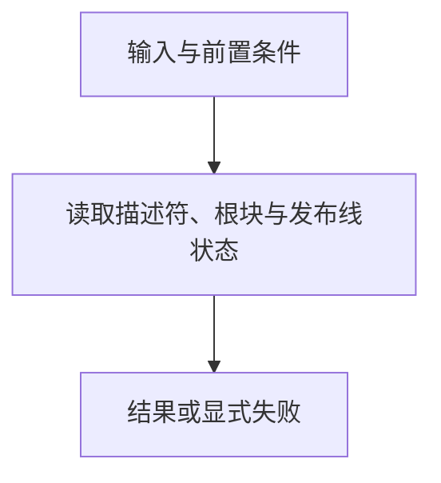

# 对外登记面

> 自动生成；请修改 `docs/architecture/modules.json` 或源码后重新 build。图是导航，不授予权限、不替代契约；声明流程不是自动证明的调用链。

模块：`registration`

## 负责 / 不负责
人工契约：[docs/architecture/OVERVIEW.md](../../../docs/architecture/OVERVIEW.md)

外部消费方登记本仓前要读的只读事实：发布线与根块是否仍与钉住的发布一致

不负责：写路径：块的生成与校验原语属于 root-policy，文件清单摘要属于 foundation

## 改动入口

| 源码位置 | 适合修改什么 |
|---|---|
| [`lib/block-report.mjs#inspectRootBlock`](../../../lib/block-report.mjs#L131) | 只读报告根块与钉住发布是否一致 |
| [`lib/release-lines.mjs#readReleaseLines`](../../../lib/release-lines.mjs#L66) | 读取并校验发布线状态 |

## 声明性主流程

流程依据：人工模块声明；锚点存在性由检查器验证，分支和时序仍需核对实现与测试。
- 读取描述符、根块与发布线状态 → [`lib/block-report.mjs#inspectRootBlock`](../../../lib/block-report.mjs#L131)

## 边界与验证

实际依赖：[descriptor](descriptor.md)、[foundation](foundation.md)、[root-policy](root-policy.md)

允许依赖：`foundation`、`descriptor`、`root-policy`

建议验证（只显示，不自动执行）：
- [`scripts/test-registration-surface.mjs`](../../../scripts/test-registration-surface.mjs)

## 本模块文件

- [`lib/block-report.mjs`](../../../lib/block-report.mjs)
- [`lib/release-lines.mjs`](../../../lib/release-lines.mjs)
- [`scripts/check-release-lines.mjs`](../../../scripts/check-release-lines.mjs)
